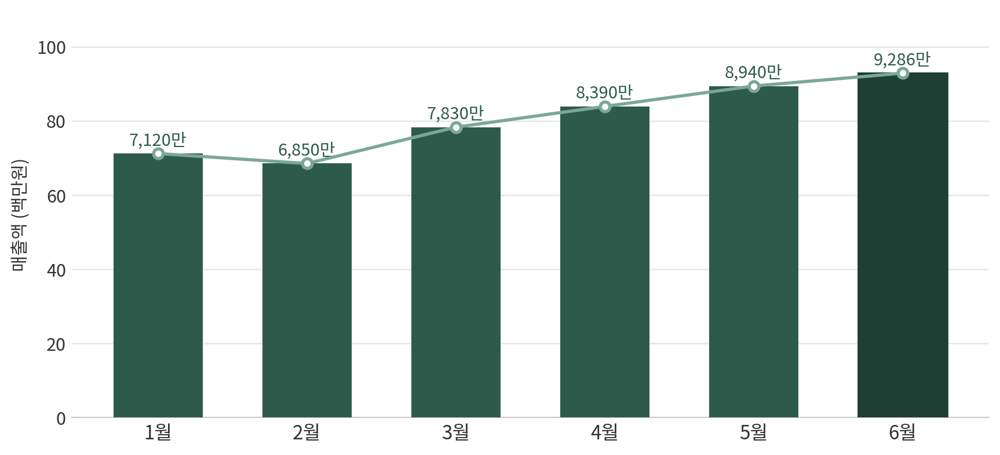
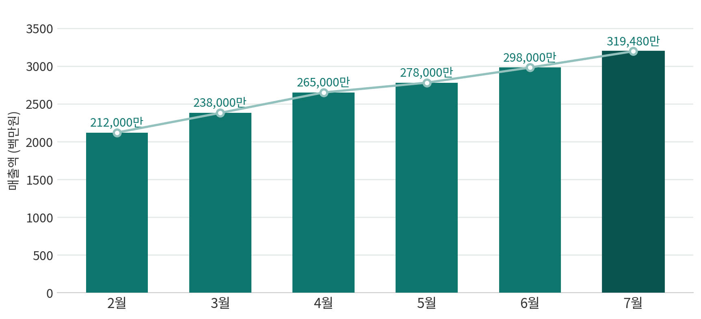

# 📊 월별 매출 분석 리포트

**사용 도구:** Claude Cowork, Word

**결과물:** 가상 월별 판매 데이터 기반 Word 보고서 2종

> 두 보고서의 브랜드, 판매량, 매출액은 보고서 제작 연습을 위해 만든 가상 데이터입니다. 실제 회사 실적이나 업무 성과가 아닙니다.

## Background

판매 데이터가 길게 나열된 문서를 의사결정에 필요한 요약, 추이, 구성비, 제품별 상세 정보로 바꾸는 과제였습니다. 같은 보고서 구조를 카페와 여행 플랫폼이라는 다른 업종에 적용해 재사용 가능성도 확인했습니다.

## Approach

- 월별 매출과 전월 대비 증감률을 계산해 추이 표와 차트로 구성했습니다.
- 카테고리별 판매 수량, 매출액, 매출 비중의 합계가 맞는지 대조했습니다.
- 제품별 상세 실적과 상위 제품 비중을 분리해 읽는 순서를 만들었습니다.
- 마지막 페이지에는 관찰된 수치에서 바로 확인할 수 있는 내용만 인사이트로 정리했습니다.
- 모든 문서에 가상 데이터라는 안내를 넣어 실제 실적과 구분했습니다.

## Result

### 픽미 카페 예시 보고서

[Word 보고서 내려받기](./picme-cafe-sample-report.docx)

### 트립모아 예시 보고서

[Word 보고서 내려받기](./tripmoa-sample-report.docx)

두 문서 모두 3쪽 분량이며 요약 지표, 월별 추이, 카테고리와 제품별 상세 표, 분석 내용을 담았습니다.

## Learned

- 같은 데이터라도 독자가 먼저 봐야 할 요약과 근거 표의 순서를 나누는 방법
- 합계와 비중을 교차 확인해 문서 자동화 과정의 계산 오류를 줄이는 방법
- 재사용 가능한 문서 구조와 실제 데이터 여부를 함께 관리하는 방법
