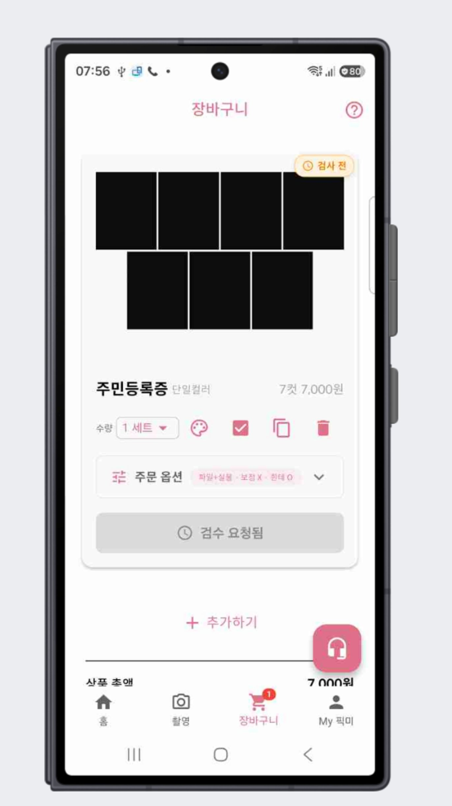
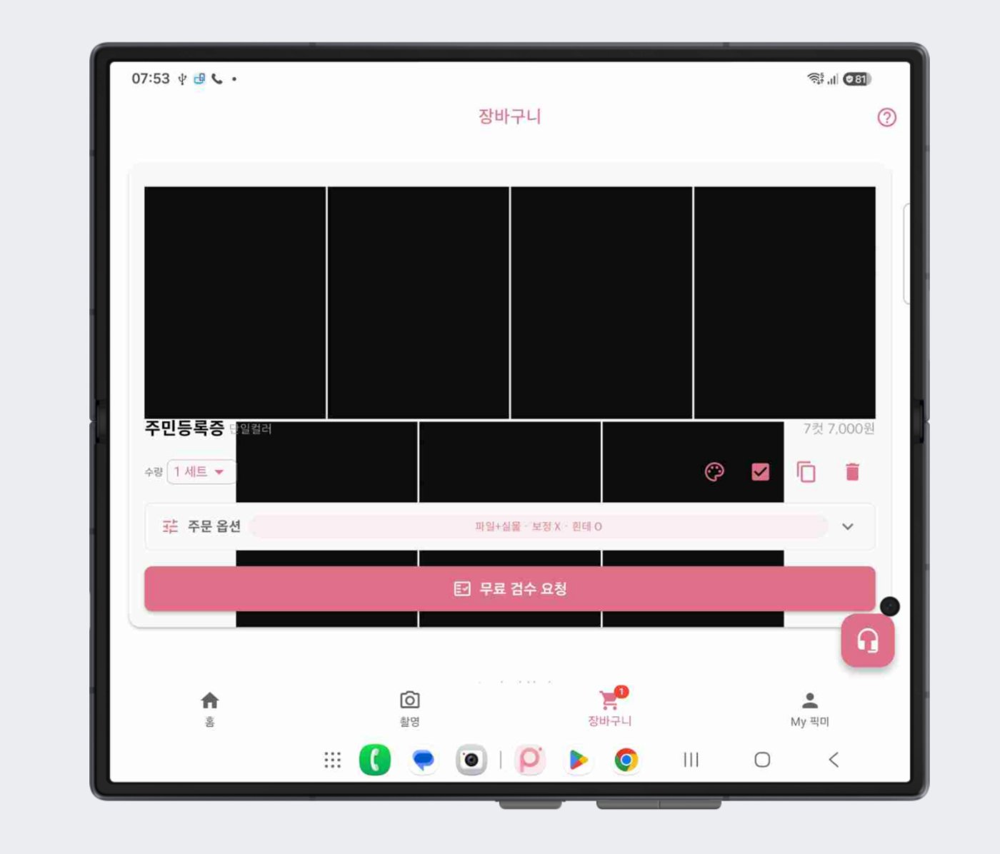
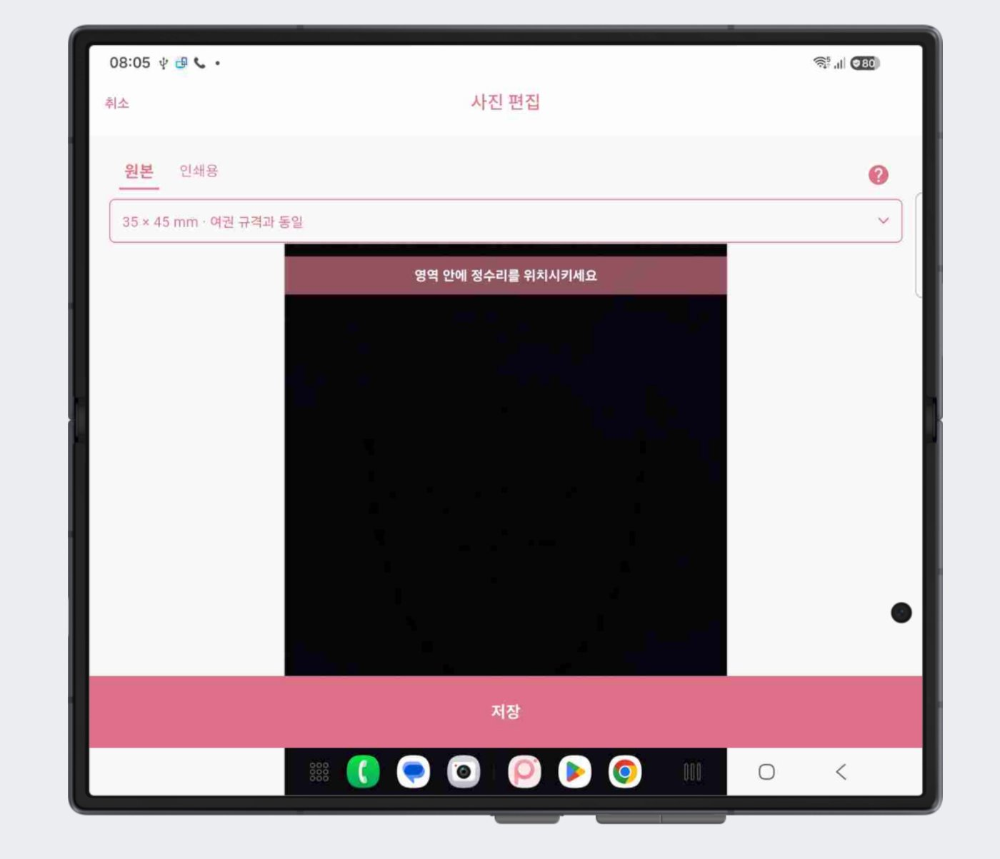
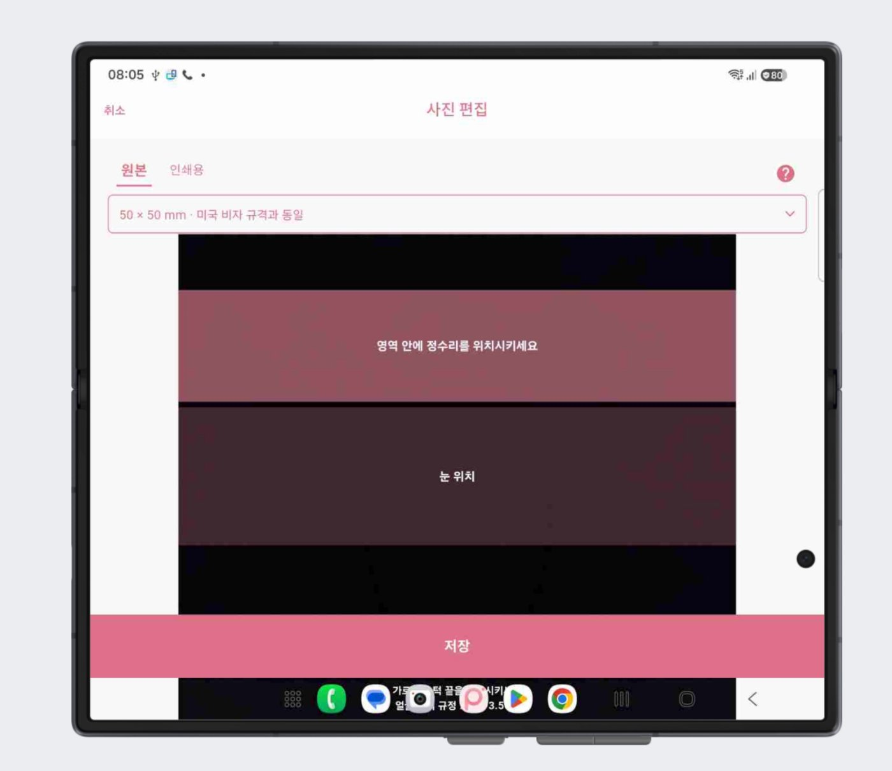
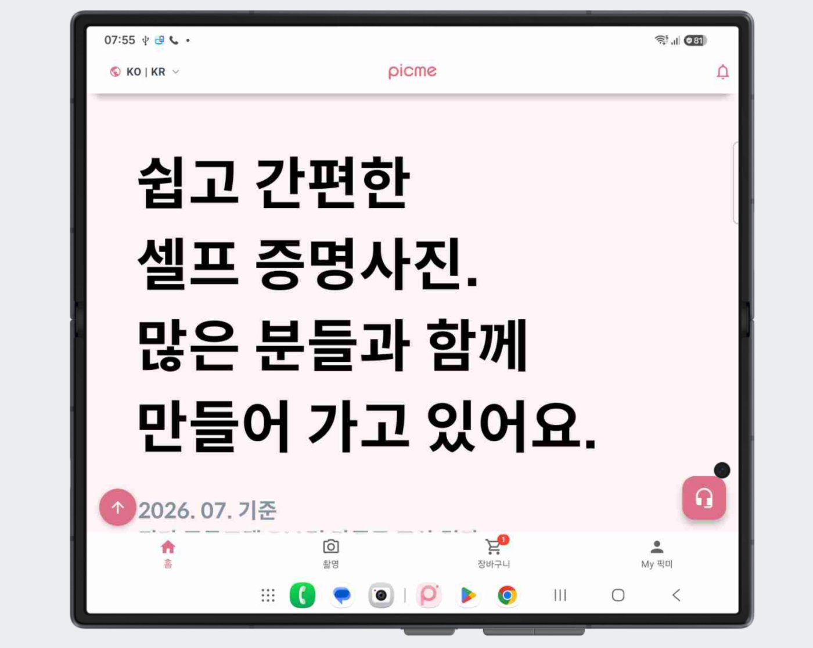

# 📲 픽미 폴더블 기기 UI QA

> 2026.10 · Samsung Remote Test Lab · **보고 4일 만에 수정 완료**

## Background

2026년 10월, Google Play에 폴드폰 사용자의 **1점 리뷰**가 등록됐습니다.
리뷰만으로는 어떤 화면이 어떻게 깨지는지 알 수 없었기 때문에, 삼성 Remote Test Lab에서 실제 Galaxy Z Fold 기기를 원격으로 사용해 직접 재현하고 점검했습니다.

## My Role

테스트 환경 구성 · 시나리오 설계 · 화면별 문제 재현 및 캡처 · 우선순위 판단 · QA 보고서 작성 · 수정 후 재검증 범위 정리

---

## Approach

### 1. 테스트 설계

| 항목 | 내용 |
|---|---|
| 테스트 서비스 | Samsung Remote Test Lab (원격 실기기) |
| 테스트 기기 | Galaxy Z Fold 시리즈 · Android 17 |
| 화면 상태 | 접은 화면 · 펼친 화면 · 가로 모드 |
| 테스트 범위 | 홈 → 촬영 · 업로드 → 사진 편집 → 장바구니 → 결제 |

같은 화면을 **접은 상태와 펼친 상태로 나란히 비교**해, 문제가 "폴더블을 펼쳤을 때만" 생긴다는 것을 먼저 확인했습니다.

### 2. 화면별 문제 재현

**접은 화면은 정상, 펼친 화면에서만 문제 발생**

| 접은 화면 (정상) | 펼친 화면 (문제) |
|---|---|
|  |  |
| 사진과 주문 정보가 정상 배치 | 사진이 커지면서 상품명 · 수량 · 옵션을 덮음 |

**사진 편집 — 주문에 꼭 필요한 화면이라 최우선 문제로 분류**

| 35×45mm 규격 | 50×50mm 규격 |
|---|---|
|  |  |
| 사진 영역이 화면을 채워 안내선 · 배경색 · 미세조정 도구가 사라짐 | 규격을 바꾸면 가이드라인과 사진 배치가 어긋남 |

**홈 — 글씨와 콘텐츠가 화면 폭에 맞춰 지나치게 커짐**

### 3. 우선순위 정리 및 보고

문제를 나열하는 데서 끝내지 않고, **주문을 막는지**를 기준으로 우선순위를 매겨 개발팀에 전달했습니다.

| 화면 | 문제 | 우선순위 |
|---|---|---|
| 사진 편집 | 사진이 잘리고 편집 도구가 표시되지 않음 | 🔴 긴급 |
| 사진 편집 | 규격 변경 시 가이드라인 · 사진 배치 비정상 | 🟠 높음 |
| 장바구니 | 사진이 확대되어 주문 정보와 겹침 | 🟠 높음 |
| 공통 | 펼친 화면에 맞는 레이아웃 미흡 | 🟠 높음 |
| 홈 | 폰트 · 콘텐츠가 화면 크기에 비해 지나치게 큼 | 🟡 보통 |

개선 요청에는 기대 동작과 함께 **"일반 스마트폰 화면은 바뀌지 않아야 한다"** 는 조건도 함께 적었습니다.

---

## Result

보고서를 바탕으로 개발팀이 바로 원인을 찾았고, **보고 4일 만에 수정**이 완료됐습니다.

- **원인** : 화면 요소가 화면 "폭"에 비례해 커지도록 만들어져 있어, 폭이 일반 폰의 약 2배인 펼친 화면에서 글씨 · 사진 · 편집 영역이 지나치게 커졌습니다. 최신 Android에서는 큰 화면에서 세로 고정 설정도 적용되지 않아 앱 설정만으로는 막을 수 없었습니다.
- **수정 내용**
  - 펼친 화면에서는 앱을 일반 폰 폭으로 가운데에 표시
  - 사진 편집 영역을 화면 높이에 맞춰 줄여 편집 도구와 저장 버튼이 항상 보이도록 수정 (가로 모드 포함)
  - 장바구니 사진이 사진 칸 안에 들어가도록 조정 — 큰 일반 폰에서 살짝 겹치던 문제도 함께 해결
  - 일반 폰 화면은 기존 그대로 유지
- **후속 과제** : 넓은 화면 전용 레이아웃(2단 구성 등)은 별도 과제로 분리
- **재검증** : 다음 버전 출시 후 실기기에서 펼친 화면 · 가로 모드 · 접은 화면 전체 주문 흐름과 보고된 4가지 문제 해결 여부를 다시 확인할 예정

## What I Learned

- 1점 리뷰 하나도 **재현하고 기록하면** 특정 기기의 숨은 문제를 찾는 단서가 된다는 점
- 원격 테스트랩으로도 실제 기기 환경을 충분히 검증할 수 있다는 점
- 정상 화면과 문제 화면을 나란히 보여주면 개발팀이 원인을 훨씬 빨리 찾는다는 점
- 우선순위와 "바뀌지 말아야 할 것"까지 함께 전달해야 수정이 빠르고 안전하게 이루어진다는 점
