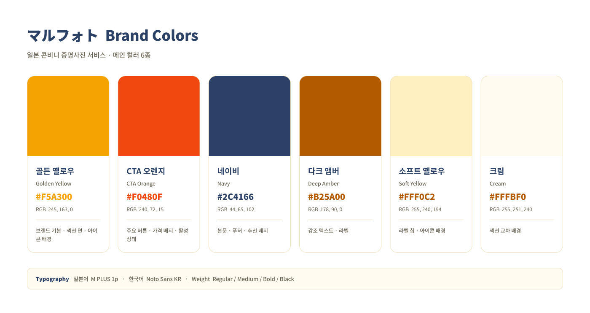
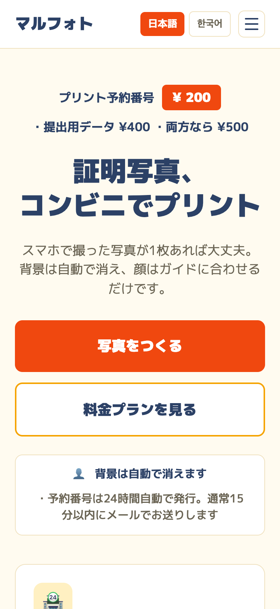
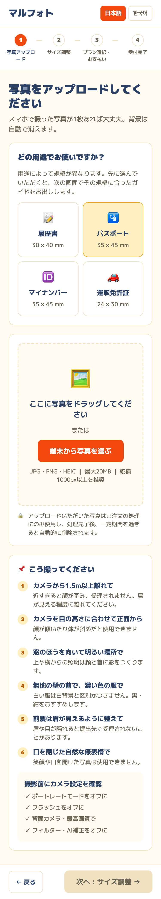
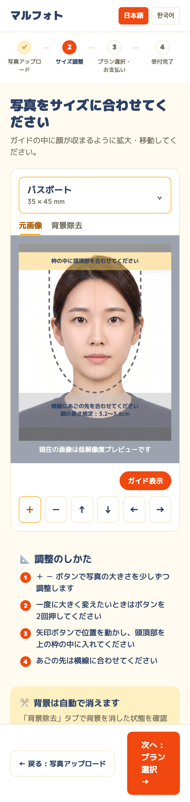
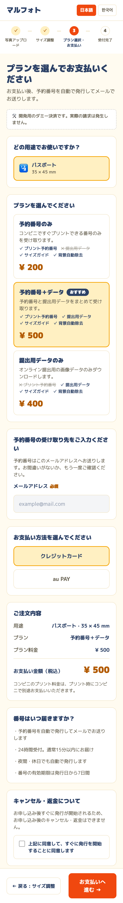
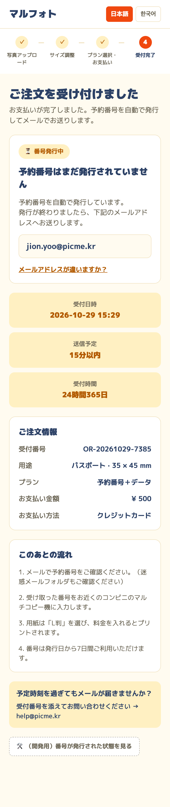

# 🇯🇵 마루포토(Maroofoto) · 일본 콘비니 증명사진 웹 서비스

> 진행 중 · 2026.09 ~ (9월 설계 → 10월 개발)
>
> 🌐 사이트: [maroofoto.com](https://maroofoto.com)

## Background

일본에는 편의점 복합기로 증명사진을 인쇄하는 수요가 있고, ピクチャン 등 선행 서비스가 시장을 점유하고 있었습니다. 기존 앱과 가격 체계가 달라 별도 브랜드의 웹 서비스가 필요했고, 인쇄 번호를 담당자가 수동 발급해야 하는 운영 제약 위에서 단기 배포 가능한 MVP를 설계했습니다.

## My Role

경쟁 서비스 분석 · 화면 설계 · 상품 구조 재설계 · 디자인 시스템 구축 · 브랜드 컬러 설계 · 한/일 UX 라이팅 · 프로토타입 제작 · AI 활용 웹 개발

## Approach

### 1. 경쟁 서비스 분석

일본 선행 서비스의 랜딩 패턴을 도출해 적용했습니다. 가격을 헤드라인 상단에 배치, 대응 편의점 브랜드 나열로 신뢰 확보, 컬러 앵커 내비게이션, 충분한 설명량.

### 2. 상품 구조 단순화

초기 5종은 조합형이라 비교가 어려웠습니다. 보정을 별도 축으로 분리하고 **배달 방식 3종**으로 정리했습니다.

| 상품 | 가격 |
|---|---|
| 콘비니 번호만 | ¥200 |
| 제출용 파일만 | ¥400 |
| 콘비니 + 파일 | ¥500 |

### 3. 운영 제약의 UX 전환

번호가 수동 발급이라 결제 후 약 30분이 걸립니다. 이를 숨기지 않고 기대치 관리 화면으로 설계했습니다.

- `인쇄 번호는 아직 발급되지 않았습니다`를 최상단에 명시
- 접수 시각 · 예상 발송 시각 · 영업시간 병기
- 번호 전달 경로 확보를 위해 메일 주소 필수화

### 4. 상품별 결과 화면 분기

단일 결과 화면은 구매하지 않은 항목까지 노출됐습니다. 상품별로 화면을 나누고, 파일은 자동 생성되므로 **파일만 구매한 경우 대기 단계를 건너뛰도록** 플로우를 분리했습니다.

### 5. 이중언어 설계

- 전 요소 Auto Layout 적용 → 번역 시 레이아웃 무손실
- 현지 용어 반영 : 복합기 → `マルチコピー機`, 인쇄 번호 → `プリント予約番号`
- 편의점 계열별 메뉴명 차이 명시 (세븐일레븐 `ネットプリント` / 그 외 `ネットワークプリント`)

### 6. 브랜드 컬러 설계

색상표 대신 **시안을 실제 랜딩 화면에 적용한 상태로** 비교했습니다. 6종을 만들어 넓은 면적에서의 피로도를 선택 전에 확인했고, 최종안은 비비드 옐로우 + 네이비로 정했습니다. 채도 높은 색은 버튼에만 남기고 넓은 면은 연한 톤으로 낮췄습니다.

폰트는 일본 웹 특유의 굵고 큰 자형을 살리되, 해당 서체에 한글 글리프가 없어 언어별로 분리 적용했습니다.

## Result

- 화면 53종 설계 (한국어 · 일본어 × 데스크톱 1440 · 모바일 375)
- 컬러 토큰 6종 · 타입 스케일 규칙 정의
- 브랜드 컬러 시안 6종 비교 후 최종안 확정
- 상품별 주문 플로우 분기 설계 및 프로토타입 연결

## Development (2026.10)

9월에 설계한 화면을 Claude를 활용해 실제로 작동하는 웹서비스로 구현했습니다.

- React · TypeScript · Tailwind 기반, 사진 업로드 → 규격 조정 → 결제 → 접수 완료까지 **17개 화면 구현**
- 일본어 · 한국어 다국어 구조 (번역 키 641개)
- Firebase 연동, 사진 보관 · 자동 삭제 정책 적용
- 회원가입 없는 주문 및 재수령 방식 설계
- 배경 제거 API 서버 연동 및 오류 처리
- 일본 증명사진 배경 규정을 공식 자료로 재검증해 안내 문구에 반영

> 결제(KOMOJU)와 편의점 번호 발급 연동은 다음 단계로 진행 예정입니다.

## Screens

[maroofoto.com](https://maroofoto.com) 모바일 화면 (2026.10 기준)

| 랜딩 | 1. 사진 업로드 | 2. 사이즈 조정 | 3. 플랜 선택 · 결제 | 4. 접수 완료 |
|---|---|---|---|---|
|  |  |  |  |  |

> 예시 인물 사진은 AI로 생성한 이미지입니다.
