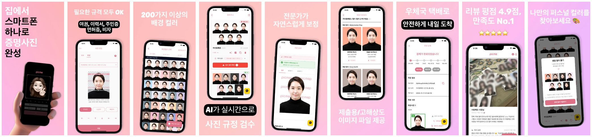
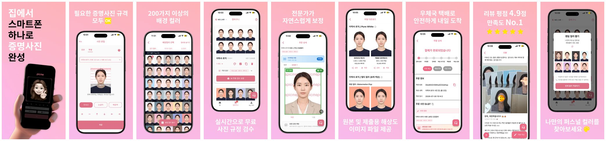
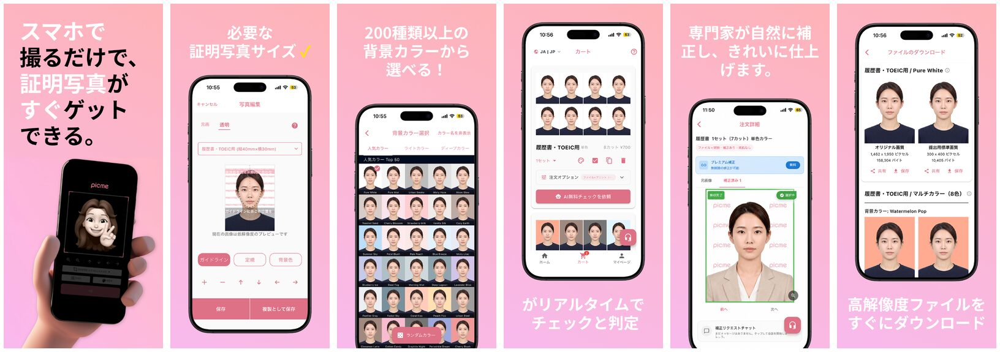
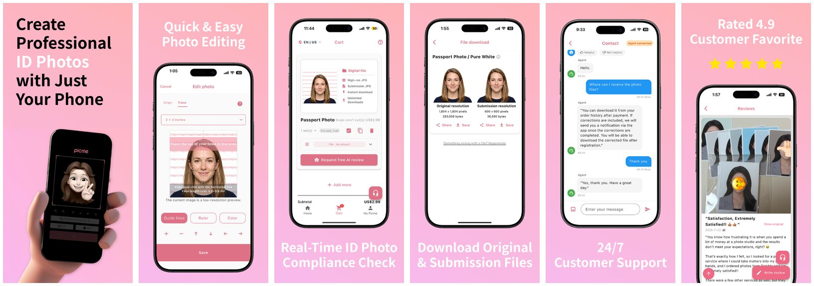

# 📱 픽미 스토어 스크린샷 제작 & App Store 심사 대응

> 2026.06 ~ 2026.10 · **10월 App Store 심사 통과** 🎉

## Background

픽미는 한국 · 일본 · 미국 스토어에 출시된 증명사진 앱입니다.
국가별 스토어 이미지가 필요했고, App Store 심사에서 **AI를 활용한 신분증 · 증명사진 위조 우려**를 이유로 반려가 이어졌습니다.
증명사진은 공식 서류에 쓰이기 때문에, 앱이 "사진을 만들어 내는 AI"가 아니라 **본인이 찍은 사진을 규격에 맞게 다듬는 서비스**라는 점을 스토어와 앱 정보에서 분명히 보여줘야 했습니다.

## My Role

스토어 스크린샷 기획 · AI 이미지 생성 · 국가별 문구 작성 · 심사 반려 사유 분석 · 스크린샷 및 메타데이터 수정 · 재심사 대응

---

## Approach

### 1. 국가별 스토어 스크린샷 제작 (6월)

AI 이미지 생성과 프롬프트를 활용해 앱 컨셉에 맞는 이미지를 만들고, 한국 · 일본 · 미국 스토어용 스크린샷을 제작했습니다.

- 앱의 핵심 흐름을 9장으로 구성 : 촬영 → 규격 선택 → 배경 컬러 → 규정 검수 → 보정 → 파일 제공 → 배송 → 리뷰 → 퍼스널 컬러
- 국가별로 문구뿐 아니라 강조점을 다르게 구성 (일본 : 이력서 · TOEIC 규격, 미국 : 여권 사진 · 24/7 고객 지원)
- AI 생성 이미지의 톤앤매너를 통일하도록 프롬프트를 반복 개선

### 2. 심사 반려 대응 (7월)

반려 사유는 **AI 관련 위조 문제**였습니다. AI가 얼굴이나 사진을 새로 만들어 공식 서류용 사진을 위조할 수 있는 앱으로 보일 수 있다는 점이 문제였습니다.

이를 해결하기 위해 "AI가 사진을 만든다"는 인상을 주는 표현을 줄이고, 본인 사진 기반의 **규격 검수 · 배경 처리 · 자연스러운 보정** 서비스라는 점이 드러나도록 정리했습니다.

- 반려 사유 분석 및 수정 범위 정리
- "AI"를 앞세운 문구를 실제 기능 중심 문구로 수정 (예: *AI가 실시간으로 사진 규정 검수* → *실시간으로 무료 사진 규정 검수*)
- 실제 최신 앱 화면으로 스크린샷 교체
- 앱 설명 및 메타데이터 수정 후 재심사 요청

### 3. 재등록 및 심사 통과 (10월)

Claude × Figma 워크플로우로 반복적인 스크린샷 수정 작업을 간소화해 재등록을 준비했고, **10월 App Store 심사를 통과**했습니다.

---

## Before / After (한국어)

**Before** — 이전 스크린샷

**After** — 최신 앱 화면과 정리된 문구로 교체

| 항목 | Before | After |
|---|---|---|
| 앱 화면 | 이전 버전 UI | 최신 버전 UI로 교체 |
| 규정 검수 | AI가 실시간으로 사진 규정 검수 | 실시간으로 무료 사진 규정 검수 (AI 강조 표현 제거) |
| 규격 안내 | 여권 · 이력서 · 주민증 · 면허증 · 비자 나열 | 필요한 증명사진 규격 모두 OK |
| 파일 제공 | 제출용 / 고해상도 이미지 파일 제공 | 원본 및 제출용 해상도 이미지 파일 제공 |

## Global Versions

**🇯🇵 일본**

**🇺🇸 미국**

---

## Result

- 한국 · 일본 · 미국 3개국 스토어 스크린샷 제작
- AI 위조 우려 반려 사유를 반영해 스크린샷 · 문구 · 메타데이터 수정
- **2026년 10월 App Store 심사 통과**

## What I Learned

- 스토어 이미지는 마케팅 자료이면서 동시에 **실제 앱을 정확히 설명하는 자료**여야 한다는 점
- 심사 반려를 "거절"이 아니라 서비스를 다른 관점에서 점검하는 기회로 활용하는 방법
- AI 기능은 사용자에게는 장점이지만, 공식 서류와 연결되면 **신뢰와 오남용 관점**에서 어떻게 보이는지도 함께 설계해야 한다는 점
- 국가별 사용자에게 같은 기능도 다르게 강조해야 한다는 점
- AI 이미지 생성과 Figma 자동화로 반복 작업 시간을 줄이는 방법
