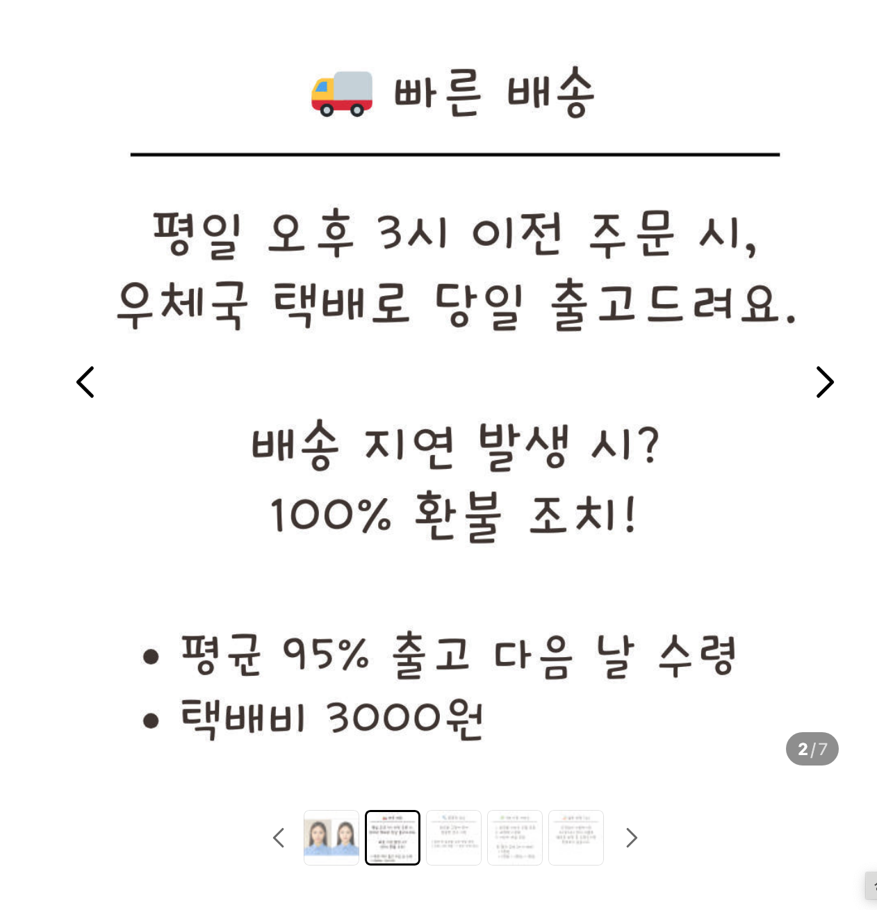
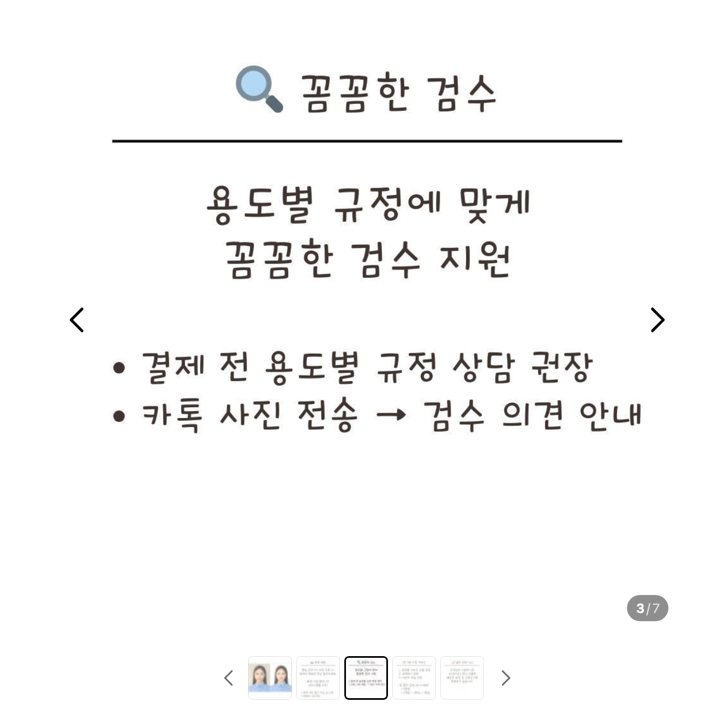
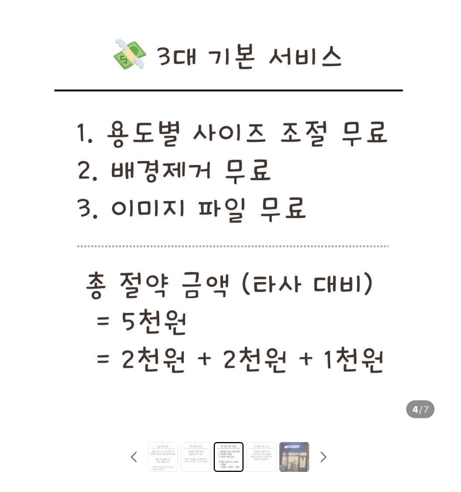
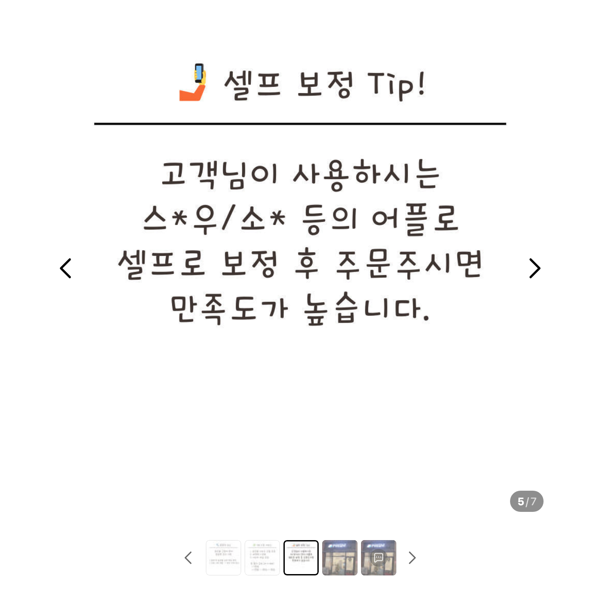
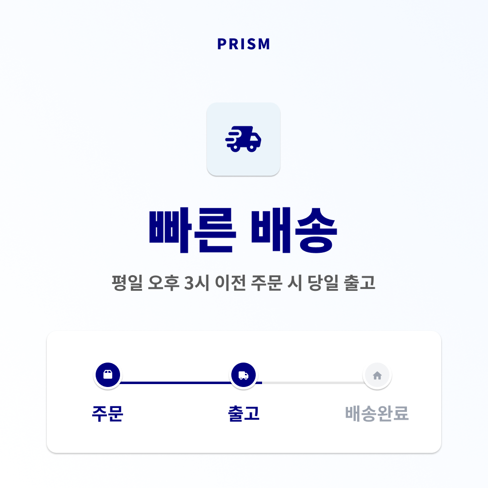
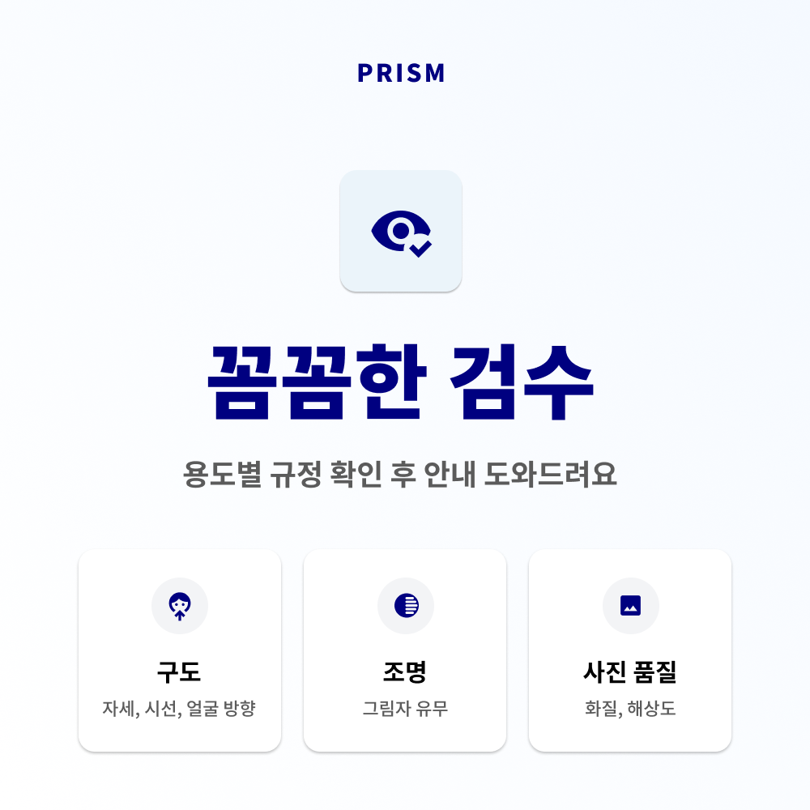
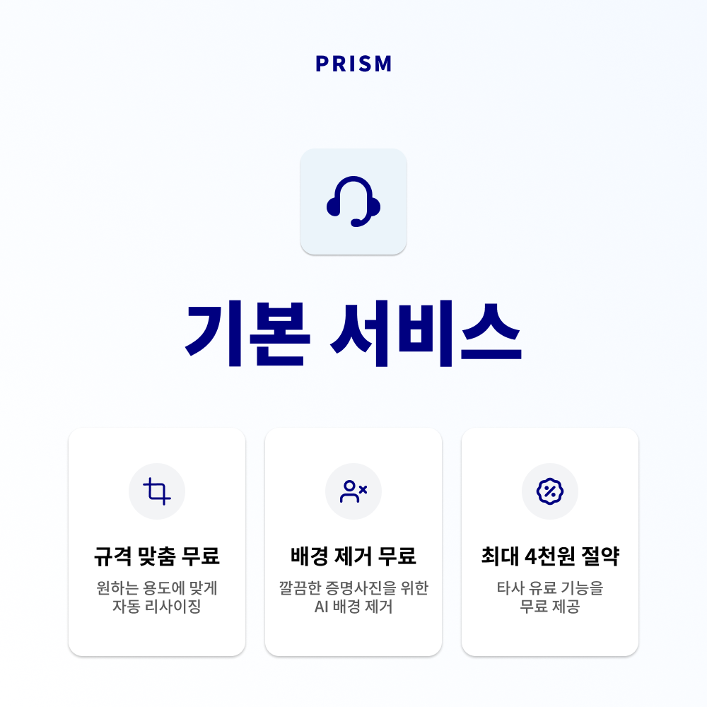
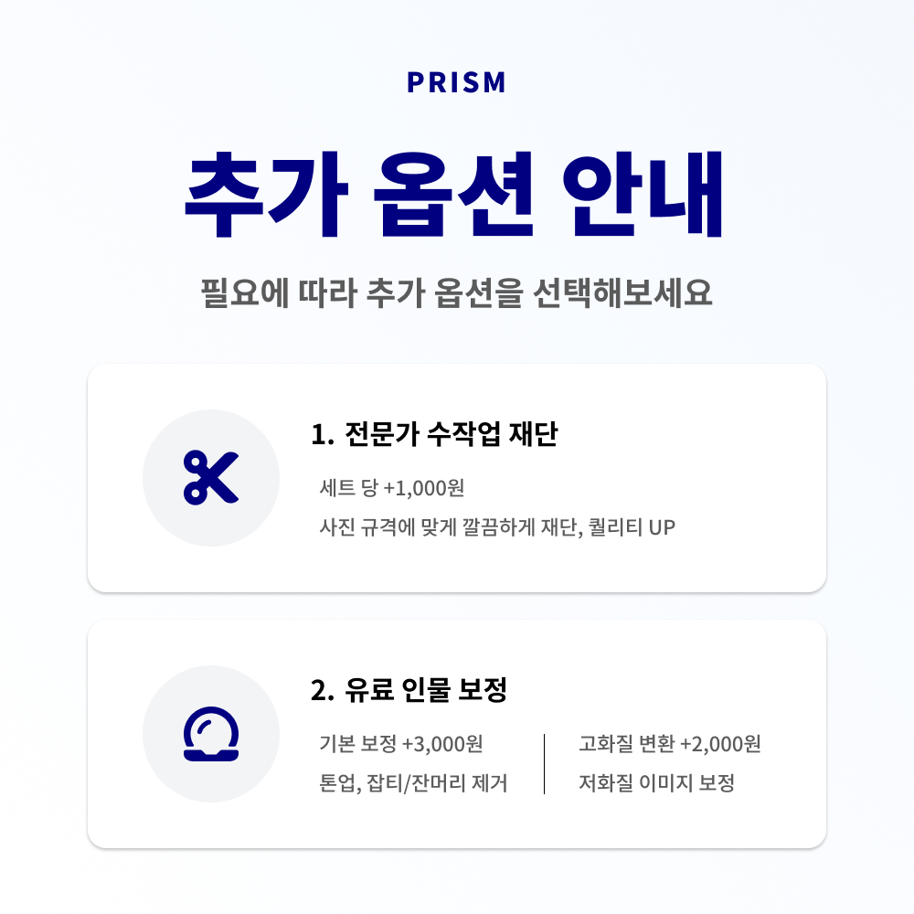
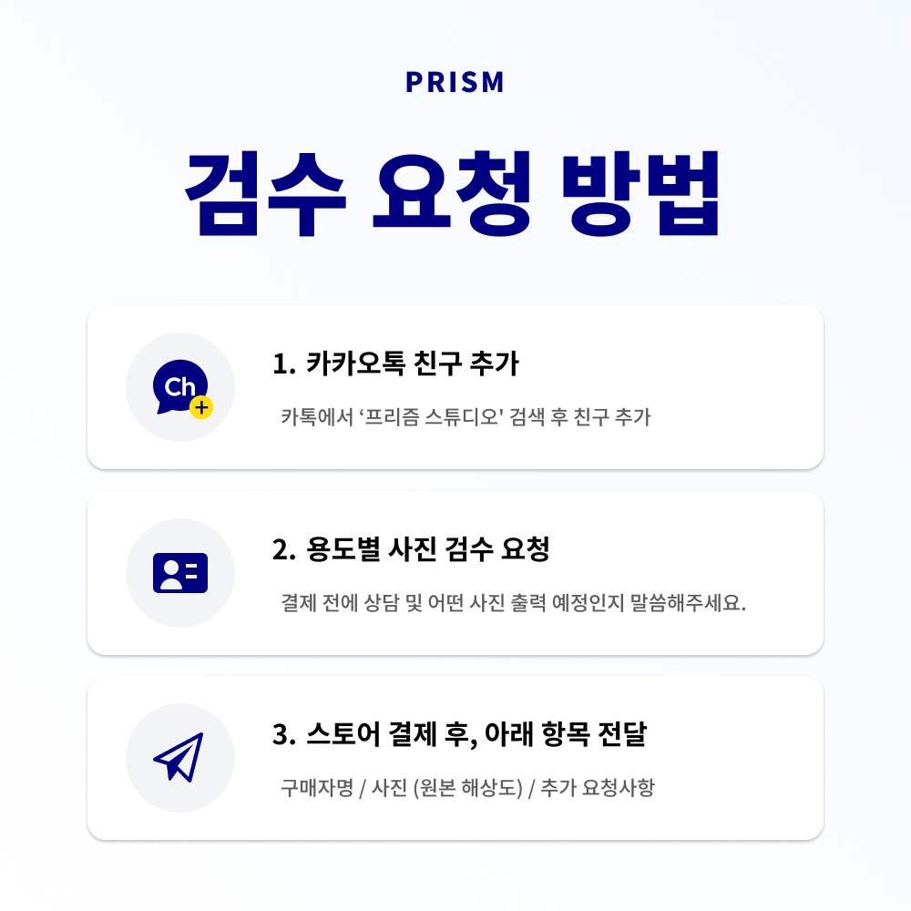

# 프리즘 증명사진 상품페이지 개선

> 2026.05 · 네이버 스마트스토어 상품 콘텐츠

## Background

프리즘 증명사진 상품은 빠른 출고, 사진 검수, 규격 조정 등 여러 장점을 제공하고 있었지만, 기존 상품페이지는 긴 문장과 서로 다른 표현 방식이 섞여 있어 핵심 혜택을 빠르게 파악하기 어려웠습니다.

사용자가 구매 전에 궁금해하는 내용을 기준으로 정보의 우선순위를 다시 정하고, 서비스 특징부터 추가 옵션과 검수 요청 방법까지 자연스럽게 이어지는 상품페이지로 개선했습니다.

---

## My Role

* 기존 상품페이지 문제점 분석
* 콘텐츠 구조 및 정보 우선순위 설계
* UX 문구 작성 및 개선
* AI 증명사진 예시 이미지 제작
* Figma 상세페이지 디자인
* 최종 상품 이미지 제작

---

## Approach

### 1. 기존 페이지 분석

기존 페이지의 내용을 사용자가 구매 전에 확인하는 질문을 중심으로 다시 분류했습니다.

* 언제 출고되는가
* 사진을 어떤 기준으로 검수하는가
* 기본 서비스에 무엇이 포함되는가
* 추가로 선택할 수 있는 옵션은 무엇인가
* 수정 요청은 어떻게 전달하는가

### 2. 정보 구조 재설계

상품의 핵심 가치가 앞부분에서 바로 보이도록 페이지 흐름을 재구성했습니다.

1. 보정 전후를 보여주는 대표 이미지
2. 빠른 배송
3. 꼼꼼한 검수
4. 기본 서비스
5. 추가 옵션
6. 검수 요청 방법

### 3. 시각 체계 통일

PRISM 브랜드 컬러와 카드형 레이아웃을 활용해 페이지마다 다른 내용을 같은 규칙으로 읽을 수 있게 만들었습니다.

* 핵심 제목과 설명의 위계 정리
* 아이콘과 짧은 문구를 활용한 정보 압축
* 서비스별 내용을 카드 단위로 구분
* 구매 흐름에 필요한 정보만 남겨 인지 부담 축소

### 4. 공개 가능한 예시 이미지 제작

실제 고객 사진 대신 AI로 생성한 증명사진 예시를 사용해 보정 전후를 시각화했습니다. 포트폴리오에도 실제 고객 사진과 주문 정보는 포함하지 않았습니다.

---

## Result

* 기존 상품 설명을 구매 전 질문 중심의 6개 화면으로 재구성
* 배송, 검수, 기본 서비스와 추가 옵션을 한눈에 비교할 수 있도록 시각화
* 검수 요청 방법을 단계별로 정리해 구매 이후의 이용 흐름까지 안내
* 브랜드 컬러와 디자인 규칙을 통일한 상품페이지 자산 제작

---

## Before

기존 페이지의 공개 가능한 화면만 사용했으며, QR 코드와 연락 채널이 포함된 운영 화면은 제외했습니다.

| 배송 안내 | 검수 안내 |
|---|---|
|  |  |

| 기본 서비스 | 보정 안내 |
|---|---|
|  |  |

---

## After

> 이미지 출처: 상품페이지의 예시 인물은 AI로 생성했습니다. 실제 고객 사진은 사용하지 않았습니다.

---

## What I Learned

* 같은 정보도 사용자의 질문 순서에 맞춰 배치하면 이해하기 쉬워진다는 점
* 상품페이지에서는 혜택을 나열하는 것보다 서비스 범위와 이용 방법을 구분해 보여주는 것이 중요하다는 점
* 디자인 요소를 일관된 규칙으로 정리하면 브랜드 인지와 정보 전달을 함께 개선할 수 있다는 점
* 실제 고객 자료를 노출하지 않고도 AI 예시 이미지로 서비스 특징을 설명할 수 있다는 점
